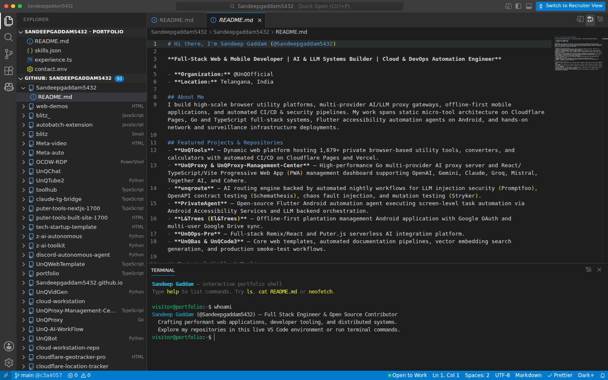
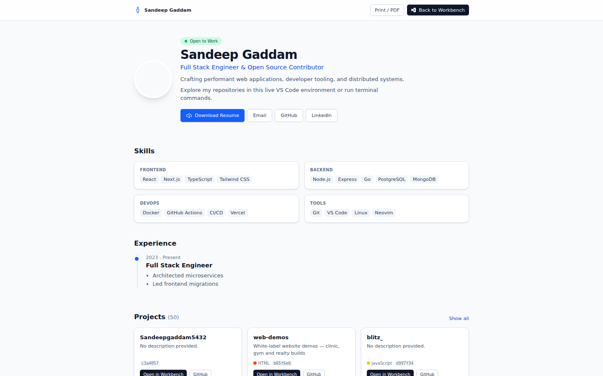
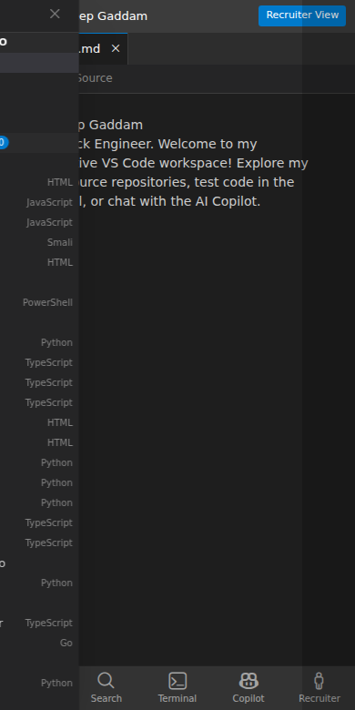
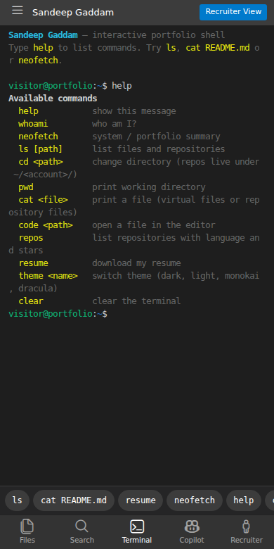

<div align="center">

# VS Code Web Workbench

### A zero-mock, fully client-side VS Code portfolio

[Live Demo](https://sandeepgaddam5432.github.io/zero-mock-vs-code-workbench/) · [GitHub Profile](https://github.com/Sandeepgaddam5432) · [Report an Issue](https://github.com/Sandeepgaddam5432/zero-mock-vs-code-workbench/issues)

[](https://github.com/Sandeepgaddam5432/zero-mock-vs-code-workbench/actions/workflows/deploy.yml)


</div>



## What is this?

This is my portfolio, presented as a working Visual Studio Code workbench instead of a traditional landing page. It is built with Next.js and exported as a completely static site. There is no backend, no database, and no runtime GitHub API dependency.

Visitors can browse my public repositories as a real file tree, open files in Monaco, preview Markdown, run terminal commands, use the command palette, switch themes, open the Recruiter View, or ask the built-in Copilot about my work.

## Why "zero-mock"?

Most developer portfolios use screenshots or simplified recreations. This one does not.

| Instead of | This project uses |
| --- | --- |
| A screenshot of an editor | The real Monaco editor |
| Fake terminal output | A working xterm.js terminal with a virtual filesystem |
| A hardcoded project list | Repository metadata and file trees synced from GitHub at build time |
| Client-side GitHub API calls | Static JSON generated during the build |
| A CDN-hosted editor | Self-hosted Monaco, Codicons and Markdown styles |
| A separate mobile "lite" site | The same workbench, adapted for small screens |

## Live demo

**https://sandeepgaddam5432.github.io/zero-mock-vs-code-workbench/**

Useful entry points:

- [Recruiter View](https://sandeepgaddam5432.github.io/zero-mock-vs-code-workbench/#/recruiter) - a concise skills and experience summary
- [Profile README](https://sandeepgaddam5432.github.io/zero-mock-vs-code-workbench/#/~/README.md) - the virtual workspace README
- [A repository README](https://sandeepgaddam5432.github.io/zero-mock-vs-code-workbench/#/Sandeepgaddam5432/toolhub/README.md) - real file content from GitHub
- [Terminal](https://sandeepgaddam5432.github.io/zero-mock-vs-code-workbench/) - press <kbd>Ctrl</kbd> + <kbd>`</kbd> and type `help`

> The site is deployed automatically to GitHub Pages by the workflow in `.github/workflows/deploy.yml`.

## Screenshots

| Recruiter View | Mobile |
| --- | --- |
|  |  |

| Mobile terminal |
| --- |
|  |

## Features

### Workbench

- Pixel-faithful layout: title bar, activity bar, explorer, tabs, breadcrumbs, editor, panel and status bar
- Real Monaco editor with syntax highlighting, minimap, word wrap, font controls and multiple themes
- Command palette, quick open, keyboard shortcuts and deep links
- Draggable split panes and resizable sidebar/panel
- Search across indexed repository metadata

### GitHub browser

- Every public repository is synced at build time and pinned to its latest commit SHA
- Real file trees, file contents, images and Markdown previews
- Noise, lockfiles, binaries and files larger than 500 KB are filtered out
- Content is served from `raw.githubusercontent.com` with a jsDelivr fallback and IndexedDB caching
- Build-time sync has rate-limit fallbacks and reuses the previous snapshot if GitHub is unavailable

### Terminal

- Real xterm.js terminal with a virtual filesystem
- Commands: `help`, `whoami`, `neofetch`, `ls`, `cd`, `pwd`, `cat`, `code`, `repos`, `resume`, `theme`, `echo`, `date`, `history`, `clear`
- Tab completion and command history

### Copilot

- Zero-key semantic assistant that works without an API key
- Optional bring-your-own-key support for OpenAI-compatible providers (Groq, DeepSeek, OpenRouter, Mistral, Ollama), Anthropic and Gemini
- Keys are stored in `sessionStorage` by default and are sent only to the provider you configure

### Mobile

- Bottom navigation for Files, Search, Terminal, Copilot and Recruiter
- Slide-over explorer and tappable terminal command chips
- Shiki-based read-only viewer instead of loading Monaco on small screens

### Privacy and accessibility

- No analytics, tracking scripts, cookies or backend
- No runtime calls to `api.github.com`
- Semantic landmarks, ARIA labels, keyboard navigation and a skip link
- Responsive from desktop to a 390 px viewport

## Tech stack

| Layer | Technology |
| --- | --- |
| Framework | Next.js 16 (App Router, static export) |
| UI | React 19, TypeScript, Tailwind CSS 4 |
| Editor | Monaco Editor |
| Terminal | xterm.js with fit, canvas and web-links addons |
| Markdown | marked, DOMPurify, github-markdown-css |
| Syntax highlighting | Shiki |
| State | Zustand |
| Search | MiniSearch |
| Icons | VS Code Codicons |
| Caching | IndexedDB via idb-keyval |
| Deployment | GitHub Actions + GitHub Pages |

## How it works

```text
portfolio.config.ts
        |
        v
scripts/sync-github.ts
        |-- public/data/manifest.json
        |-- public/data/trees/<account>-<repo>.json
        |-- public/monaco/vs/**
        |-- public/vendor/github-markdown-*.css
        |
        v
next build (STATIC_EXPORT=1)
        |
        v
       out/  --->  GitHub Pages
```

The application itself is entirely client-side. GitHub is contacted only during the build, when the sync script resolves repositories, commit SHAs, file trees and READMEs. The exported site contains all data and assets it needs.

## Quick start

Requirements: Node.js 22 or newer and npm.

```bash
git clone https://github.com/Sandeepgaddam5432/zero-mock-vs-code-workbench.git
cd zero-mock-vs-code-workbench
npm ci --legacy-peer-deps
npm run dev
```

Open [http://localhost:3000](http://localhost:3000).

### Scripts

| Command | What it does |
| --- | --- |
| `npm run dev` | Start the Next.js development server |
| `npm run build` | Sync GitHub data and create a standard production build |
| `npm start` | Serve the standard production build |
| `npm run build:static` | Create a fully static export in `out/` |
| `npm run sync` | Refresh repository data without building |
| `npm run typecheck` | Run TypeScript checks |
| `npm run lint` | Run ESLint |

## Configuration

### Portfolio identity

Edit `portfolio.config.ts` to change:

- Profile name, handle, role, bio and status
- Contact links
- Skills and experience
- Pinned repositories
- Virtual workspace files such as `README.md`, `skills.json`, `experience.ts` and `contact.env`

### Environment variables

| Variable | Purpose |
| --- | --- |
| `NEXT_PUBLIC_GITHUB_USERNAME` | Index a single GitHub account |
| `NEXT_PUBLIC_GITHUB_ACCOUNTS` | Index multiple accounts, comma-separated |
| `GITHUB_TOKEN` | Authenticate the build-time sync to avoid rate limits |
| `NEXT_PUBLIC_BASE_PATH` | Serve the site under a subpath, such as a GitHub Pages project site |
| `STATIC_EXPORT` | Set to `1` to enable Next.js static export |

If no account is provided, the build falls back to `Sandeepgaddam5432`.

## Deploying to GitHub Pages

The repository is ready for GitHub Pages:

1. Push to `main`.
2. In **Settings → Pages**, set **Source** to **GitHub Actions**.
3. The workflow installs dependencies with `npm ci`, runs `npm run build:static`, uploads `out/` and deploys it.

The workflow uses `actions/configure-pages` to inject the correct `NEXT_PUBLIC_BASE_PATH` for project sites. No manual base-path editing is required. A daily scheduled run refreshes the repository snapshot.

For a custom domain, add the domain in **Settings → Pages** and configure DNS. The base path can then remain empty.

## Project structure

```text
.
├── .github/workflows/deploy.yml   GitHub Pages deployment
├── docs/screenshots/              README screenshots
├── portfolio.config.ts            Profile, skills, experience and virtual files
├── scripts/sync-github.ts         Build-time GitHub sync and asset self-hosting
├── public/
│   ├── data/                      Generated manifest and repository trees
│   ├── monaco/vs/                 Self-hosted Monaco
│   └── vendor/                    Self-hosted Markdown styles
├── src/
│   ├── app/                       Next.js App Router entry and health route
│   ├── components/                Workbench, editor, terminal, views and UI
│   └── lib/                       Store, virtual filesystem, search, themes and Copilot
└── next.config.ts                 Static export and base-path support
```

## Privacy and security

- The deployed site has no backend and makes no GitHub API requests at runtime.
- File content is fetched from GitHub's raw content hosts and cached locally in IndexedDB.
- Copilot keys are optional, stored in `sessionStorage` by default, and never sent anywhere except the provider selected by the visitor.
- Markdown is sanitized with DOMPurify before rendering.
- Repository data is generated at build time from public sources.

## Credits

Built with [Next.js](https://nextjs.org), [Monaco Editor](https://microsoft.github.io/monaco-editor/), [xterm.js](https://xtermjs.org), [Tailwind CSS](https://tailwindcss.com), [Shiki](https://shiki.style), [marked](https://marked.js.org), [DOMPurify](https://github.com/cure53/DOMPurify), [github-markdown-css](https://github.com/sindresorhus/github-markdown-css) and [VS Code Codicons](https://github.com/microsoft/vscode-codicons).

## Contact

- GitHub: [@Sandeepgaddam5432](https://github.com/Sandeepgaddam5432)
- Live portfolio: [sandeepgaddam5432.github.io/zero-mock-vs-code-workbench](https://sandeepgaddam5432.github.io/zero-mock-vs-code-workbench/)

No license has been declared for this repository. The source is published for viewing and portfolio purposes; please open an issue before reusing substantial parts.
